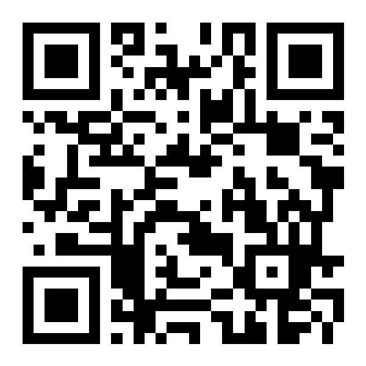

# speed-app

Mobile web app (PWA) that shows real-time speed (GPS) inside a compass ring that stays parallel to the ground.

**Live app:** https://ilanhazan-max.github.io/speed-app/

Scan to open it on your phone:

- Open over HTTPS on a phone and tap the start button to grant location and motion access.
- Add `?demo` to the URL to see simulated data on a desktop.
- Tap the unit to switch between km/h and mph.
